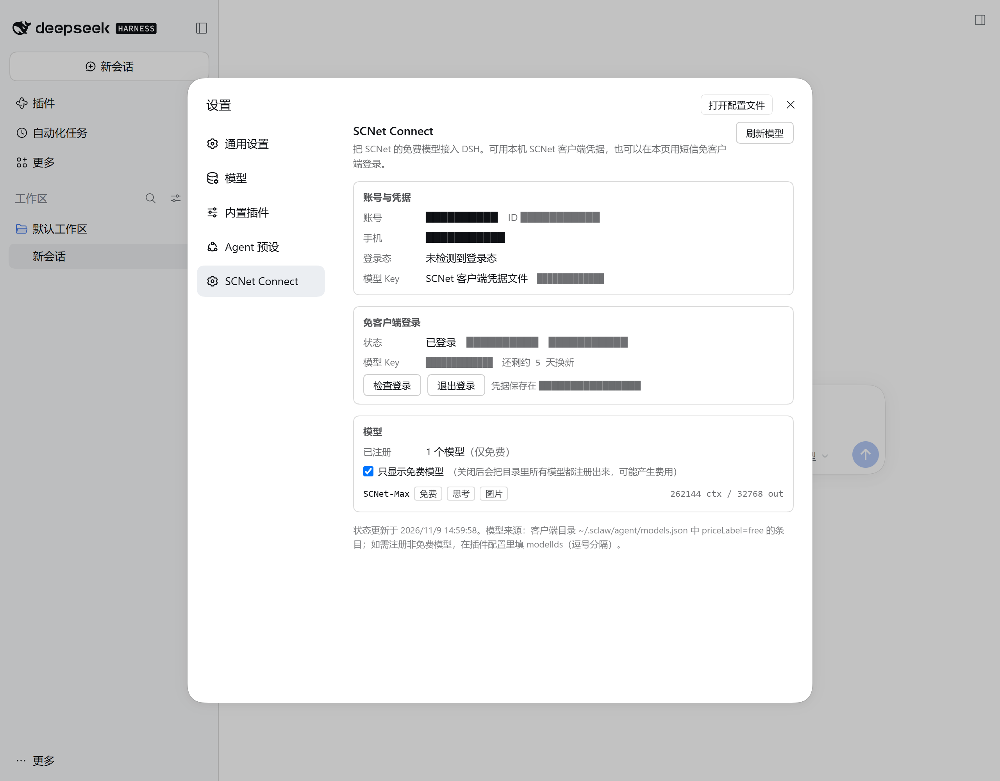
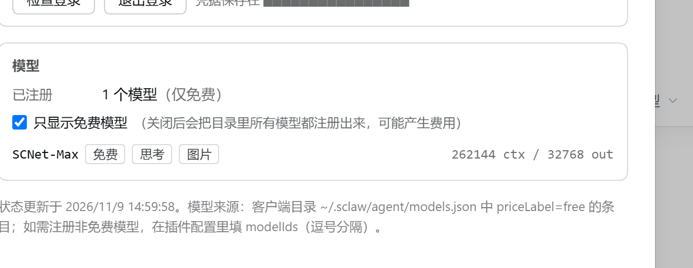

# SCNet Connect

[](https://www.npmjs.com/package/dsh-scnet-connect)
[](LICENSE)

把 **SCNet 模型**接入 [DeepSeek Harness](https://github.com/deepseek-ai/deepseek-harness)。
可**免客户端登录**，使用免费模型（`SCNet-Max`，基座为 DeepSeek Flash 系列 —— 实测与 `DeepSeek-V4.1-Flash-1017` 行为一致，证据见 [基座认定](#基座认定scnet-max-与-deepseek-v41-flash-1017-的行为比对)）。

- **零客户端**：不装 SCNet 桌面客户端，用手机短信登录即可使用
- **零配置**：装了客户端的话，自动读凭据、自动发现免费模型
- **设置页管理**：账号、登录、模型开关都在 DSH 设置里
- **1M 上下文**：`SCNet-Max` 按平台真实能力声明 `contextWindow: 1048576` / `maxTokens: 131072`（实测 104.5 万 token 输入通过、1.06M 被拒；同样的直连调用方式见 [`tools/repro/scnet-chat.mjs`](tools/repro/scnet-chat.mjs)）
- **抖动自愈**：平台偶发的 `503 + 10008`（路由切换）和**流中途被掐断**（`The response stream was interrupted`）都会被归一化成可重试错误，自动退避重试而不是整轮失败
- **用量可见**：设置页显示累计输入/输出 token、缓存命中与最近一次请求（不走新路由，数据只在本机）
- **对话页账号徽标**：选中 SCNet 模型后，输入框左侧显示当前账号或「未登录」，点一下直接打开本插件设置页



---

## 基座认定：SCNet-Max 与 DeepSeek-V4.1-Flash-1017 的行为比对

`SCNet-Max` 在平台目录里的 `description` 只有四个字（`SCNet-Max`），没有任何基座标注。下面是一组可复现的实测，用来判断它的基座。

对比对象为 `DeepSeek-V4.1-Flash-1017`。


### 证据一：分词器与对话模板完全一致

同一字符串在两侧算出的 `prompt_tokens` 逐项相同（22 个探针，22 个一致）：

| 探针 | 两侧 `prompt_tokens` |
| --- | --- |
| `"Hi"`（模板开销） | 31 |
| 中文 | 36 |
| 阿拉伯语 | 40 |
| 印地语 | 47 |
| 泰语 | 43 |
| 韩语 | 41 |
| 家庭 emoji（ZWJ） | 52 |
| 旗帜 emoji | 46 |
| 4 字节 CJK（`𠀋𠀌𠀍`） | 43 |
| 零宽字符 + 组合音标 | 39 |
| 代码块 | 44 |
| base64 | 66 |
| JSON | 41 |
| 400 个 ASCII | 80 |
| 200 个「中」 | 230 |

基准串 `"Hi"` 在两侧都是 **31** token，说明 chat template 也一致。

### 证据二：`temperature=0` 下逐字输出

8 道确定性短题，其中 7 道字节级完全相同（sha256 前 8 位）：

| 题目 | 输出 | sha256[:8] |
| --- | --- | --- |
| 输出 JSON `{"ok":true}` | `{"ok":true}` | `4062edaf75` |
| 列出 1 到 5 | `1, 2, 3, 4, 5` | `43f0c4c6d1` |
| `"hello world"` 转大写 | `HELLO WORLD` | `787ec76dca` |
| 斐波那契第 10 项 | `55` | `02d20bbd7e` |
| 3 的 5 次方 | `243` | `72440a20f5` |
| `"abc"` 反转 | `cba` | `6d970874d0` |
| 2024 是否闰年 | `是` | `b5141d3d19` |

唯一不同的是自由论述题（「用一句话解释哈希表」）。该题在 `temperature=0.7` 复测时，两侧各采样出**完全相同的一整句**：

```text
哈希表是一种通过哈希函数把键映射到存储位置，从而以平均常数时间实现键值查找、插入和删除的数据结构。
```

跨两个不同网关各自采样，能撞出整句相同的汉语，基本排除「不同模型」的可能。

### 证据三：知识边界重合

| 事实 | 两侧答案 |
| --- | --- |
| Gemini 3 发布 | 2025-11-18 |
| GPT-5 发布 | 2025-08-07 |
| Claude 4 发布 | 2025-05-22 |
| 2026 春节 | 2026-02-17 |
| 2025 诺贝尔文学奖 | 拉斯洛·克拉斯纳霍尔凯（László Krasznahorkai） |
| DeepSeek V4 | 均否认已发布（「截至 2026-04 / 2026-05」） |
| DeepSeek-V4.1-Flash-1017 | 均不认识 |

两侧都不认识自己的发布名——模型对自身 release 无知属正常现象，不构成反证。

### 证据四：网关实现不同（证明这是两个独立部署）

| 字段 | SCNet-Max | 对比侧 |
| --- | --- | --- |
| `prompt_cache_hit_tokens` / `prompt_cache_miss_tokens` | 无 | 有（DeepSeek 原生 schema） |
| `service_tier` | 有 | 无 |
| `system_fingerprint` | 字段缺失 | `""` |

### 结论与残留不确定性

**可以确定**：`SCNet-Max` 与 `DeepSeek-V4.1-Flash-1017` 在 tokenizer、chat template、知识边界、确定性输出上全部一致，属**同一模型**。

**不能确定**：SCNet-Max 究竟是 `1017`，还是更早的 `DeepSeek-V4.1-Flash-0910`。DeepSeek 历代模型共用同一 tokenizer。


## 安装

三种方式，任选其一。

### 方式一：DSH 插件页直接安装（最简单）

打开 DSH 的 **插件** 页，在搜索/安装框里输入包名：

```text
dsh-scnet-connect
```

点安装即可。装完重启 DSH，或改一下 profile 的 `cordis.patch.yml` 触发热重载。

### 方式二：命令行安装（npm）

```bash
dsh plugin --profile desktop add dsh-scnet-connect
```

### 方式三：从源码安装

```bash
git clone https://github.com/Phoeky/dsh-scnet-connect.git
cd dsh-scnet-connect
dsh plugin --profile desktop add link:.
```

> 装完如果没生效，改一下 profile 的 `cordis.patch.yml`（加一行注释再保存）触发热重载，或重启 DSH。

---

## 快速开始
### 方式一：免客户端登录（推荐）

打开 **设置 → SCNet Connect**：

1. 填手机号 → 点「获取验证码」→ 输入图形验证码
2. 点「发送短信验证码」→ 填收到的 6 位验证码
3. 点「登录」

登录成功后插件会自动换取模型 Key，无需其他操作。

**没有 SCNet 账号也能用。** 插件会根据平台返回的「该手机号是否已注册」自动选路：

| 手机号状态 | 插件行为 |
| --- | --- |
| 已注册 | 走短信快捷登录，直接进入 |
| 未注册 | **自动为你注册一个 SCNet 账号**，然后继续登录 |

注册由平台完成（等同于你在官网用手机号注册），插件只负责发起与跟随跳转。
完成后设置页会提示「登录成功，已为你自动注册 SCNet 账号」，不会静默建号。

新账号第一次换取模型 Key 时，平台会回「模型服务尚未开通」；插件会自动调用
平台的 `account/config/authorize` 完成开通再重试，全程无需你去控制台操作。

> **如果提示「平台把这次提交当成了账号密码登录」**：说明平台把这次短信提交
> 落到了它的密码分支。请点「刷新验证码」重新获取图形验证码，再重新发送一次
> 短信码重试。插件会把平台返回的原始码与原文记进
> `$DSH_HOME/scnet-connect-status.json` 的 `login.lastFailure`，
> 方便反馈问题时定位。
>
> 登录页面的报错一律显示中文；平台原始英文文案只进诊断文件，不会出现在界面上。

### 方式二：用本机 SCNet 客户端

先装好 SCNet 客户端并登录，正常发起一次对话（让客户端把凭据落到本地）。
插件会自动读取凭据，客户端之后可以关掉。

---

## 使用

在 DSH 的模型选择器里选 **SCNet Connect → SCNet-Max**。

设置页可以：

| 功能 | 说明 |
| --- | --- |
| 查看账号 | 用户名、ID、脱敏手机号、登录态剩余天数 |
| 登录 / 退出 | 短信登录；退出后插件停止供 Key，可随时「恢复使用」 |
| 只显示免费模型 | 默认开启。关闭后会把目录里所有模型都注册出来（可能产生费用） |
| 刷新模型 | 重新读模型目录并用网关校验可用性 |
| Token 用量 | 累计输入/输出、缓存命中、最近一次请求；数据只在本机 |
| 对话页账号徽标 | 选中 SCNet 模型后显示在输入框左侧；点击打开本插件设置页 |



### Token 用量

1.3.0 起，设置页会多一张 **Token 用量** 卡片：

| 字段 | 含义 |
| --- | --- |
| 累计 | 本机、本 profile 累计的输入 / 输出 token |
| 缓存 | 缓存命中的输入 token（上游有上报时）；有写入时同时显示写入量 |
| 最近一次 | 最近一次请求的模型、输入 / 输出与时间 |
| 请求数 | 真正带 token 计数的请求次数（连接没建立就失败的不算） |

数据来自 pi-ai 的 terminal usage，写在 `$DSH_HOME/scnet-connect-usage[.<profile>].json`，只包含计数和模型 id，不含 prompt、Key 或 Cookie。它不新增 HTTP 路由，直接复用 `/status` 响应传给设置页；`recordUsage: false` 可关闭。删掉该文件即可清零。

> SCNet 当前不返回 `cacheRead` / `cacheWrite` 字段，所以缓存命中通常显示 0；这不是插件没统计，而是上游没有提供。将来网关补上字段会自动开始记录。

### 对话页账号徽标

选中 `SCNet Connect → SCNet-Max` 后，输入框工具栏里、模型选择器左侧会出现一枚小徽标：

| 状态 | 显示 |
| --- | --- |
| 已登录 | `SCNet · 用户名`（没有用户名时显示「已登录」），左侧绿点 |
| 未登录 / 已停用 | `SCNet · 未登录` / `SCNet · 已停用`，左侧红点 |
| 状态读取失败 | `SCNet · 状态未知`，悬停给出原因 |

点徽标会直接打开「设置 → SCNet Connect」，不需要再走侧边栏设置；账号信息每 30 秒或窗口重新获得焦点时刷新一次。它只在当前会话选中的是 `scnet` 模型时出现，不会干扰其他 provider。

---

## 配置

全部有默认值，一般不用改。需要时在 profile 的 `cordis.patch.yml` 里给 entry 加 `config`：

```yaml
- id: scnet-connect
  name: dsh-scnet-connect
  config:
    freeOnly: true           # 只注册免费模型（默认开）
    credentialSource: auto   # auto | client | login
    modelIds: ''             # 逗号分隔；留空 = 自动发现
    contextWindow: 0         # 0 = 跟随目录/默认
    maxTokens: 0             # 0 = 跟随目录/默认
    recordUsage: true        # 记录 token 用量并显示在设置页
```

<details>
<summary>全部字段</summary>

| 字段 | 默认 | 说明 |
| --- | --- | --- |
| `credentialSource` | `auto` | `auto` 先客户端再登录；`client` 只用客户端；`login` 只用设置页登录 |
| `freeOnly` | `true` | 只注册 `priceLabel=free` 的模型 |
| `credentialDir` | 空 | 默认 `~/.sclaw/agent/scnet-credentials` |
| `apiKey` | 空 | 直接指定 Key（会明文存在配置文件里） |
| `baseUrl` | `https://api.scnet.cn/api/llm/v1` | 网关地址 |
| `modelIds` | 空 | 指定模型 id，逗号分隔 |
| `modelName` | 空 | 自定义显示名（仅单模型时生效） |
| `contextWindow` / `maxTokens` | `0` | 覆盖上下文/输出上限 |
| `inputImages` | `true` | 是否声明接受图片 |
| `reasoning` | `true` | 是否声明支持思考等级 |
| `verifyWithGateway` | `true` | 刷新时用 `GET /models` 校验 |
| `retryOnTransientErrors` | `true` | 把 SCNet 的瞬时抖动改写成可重试错误：`5xx` 却标 `invalid_request_error`、以及流中途被掐断（见下） |
| `recordUsage` | `true` | 记录 token 用量（输入/输出/缓存命中）；关闭后设置页不再统计 |

</details>

### 运行时开关与清单位置

| 状态 | 文件 | 说明 |
| --- | --- | --- |
| 「只显示免费模型」 | `$DSH_HOME/scnet-connect-preferences.json` | 设置页切换后会记住；**优先级高于配置文件里的 `freeOnly`**。想回到配置文件的值，删掉这个文件 |
| 「退出登录 / 恢复使用」 | `$DSH_HOME/scnet-connect-suspended.json` | 退出后连客户端凭据一并停用，重启 DSH 仍生效 |
| 免客户端登录会话 | `$DSH_HOME/scnet-session.json` | 含 Cookie 与 `sk-` key（创建时按 `0600`），退出即删 |
| Token 用量 | `$DSH_HOME/scnet-connect-usage[.<profile>].json` | 输入/输出/缓存命中累计与最近一次请求；不含 prompt/Key |
| 诊断快照 | `$DSH_HOME/scnet-connect-status[.<profile>].json` | 只读排障用，`registered` / 模型 / 掩码 key；文件名带 profile，多个 profile 不会互相覆盖 |

### 关于模型元数据

模型描述符的字段来源是**配置 > 客户端目录 > 内置默认**，但有两处按目录的真实语义读：

- **输入能力**：目录里没写 `input` 就按纯文本处理（不会凭空给陌生模型加图片能力）；
- **思考等级**：目录里 `thinkingMode: "levels"` 或 `reasoning: true` 才算支持思考。当前 `SCNet-Max` 的目录条目是 `reasoning: false` + `thinkingMode: "levels"` —— 客户端 UI 也是按分等级展示的，所以插件判为支持；
- **工具调用**：目录标 `toolCalling: false` 的模型仍会注册（DSH 是 agent，无法在描述符里表达「不下发工具」），但设置页会给它打「不支持工具」标，选中前请留意。

### 图片输入

1.2.1 起可以往对话里直接贴图/拖图。SCNet 网关本身支持视觉输入，实测：

```text
上传一张纯红色 8×8 PNG，问「这张图片主要是什么颜色？」
→ HTTP 200，回答「红色」，prompt_tokens=226
```

如果插件没把 DSH 的附件服务接到 adapter 上，DSH 会在发出请求前就拦下来：

```text
pi-ai image input requires the durable attachment service
```

这条报错来自 DSH 核心，含义是「这个 provider 没声明自己能处理持久化图片附件」。
插件通过 `resolveAttachments` / `resolveImageAccess` 两个钩子把 `ctx.get('attachments')`
与 `ctx.get('fs')` 接进去，图片才会被投影成网关认识的 base64 图片块。

> 在 headless/TUI profile 里如果没有挂载附件服务，这两个钩子会返回 `undefined`，
> 发图片仍会得到上面那条明确报错 —— 这是预期行为，不是插件故障。

### 关于 `retryOnTransientErrors`

SCNet 在推理实例切换/回收时会返回这种响应：

```json
HTTP 503
{"error":{"message":"The model's routing or availability changed while processing the request. Please try again.","type":"invalid_request_error","code":"10008"}}
```

状态码是 5xx，但响应体 `type` 写的是 `invalid_request_error`。DSH 的错误归类按正则顺序扫描文本，`invalid.?request` 排在 `5xx → SERVER` 前面，于是把它判成 **`INVALID_REQUEST`（不可重试）**，一次退避都不做，本轮直接失败。

插件默认把这层归一化打开：只针对「状态码 ≥ 500 且 `type` 是 `invalid_request_error`」的响应，把 `type` 改写为 `api_error`（状态码与 message 原样保留），让归类落到 `SERVER`，交给 DSH 的 5 次指数退避重试。

刻意不碰的：真正的 `400`（如参数错误 `10013`）、`401/403/402/429`、以及普通 2xx 响应。

实测（本地假网关，前 2 次返回上述 503）：

| 配置 | chat 请求数 | 结果 |
| --- | --- | --- |
| `retryOnTransientErrors: false` | 2（无重试） | 失败，`code: INVALID_REQUEST` |
| `retryOnTransientErrors: true`（默认） | 4（2 次 503 后成功） | 正常完成 |

### 流中途被中断（1.2.2 起）

同一层归一化还覆盖另一种抖动：**响应流已经开始了，上游在中间插一个 `error` 帧把流掐掉**。

```
data: {"error":{"message":"The response stream was interrupted. (request_id: bec198bdb37b73f0-20261110111508406)"}}
```

这类失败原本完全不可重试，原因有一条链路：

1. OpenAI SDK 读到该帧后抛 `APIError(undefined, data.error)`；
2. pi-ai 的 catch 把 `formatProviderError(normalizeProviderError(error))` 写进 `errorMessage`，就是上面那句原文；
3. DSH 的 `classifyPiAiError` 对这句原文**一条正则都不命中**——没有状态码、没有 `timeout`、没有 `connection`/`socket`——于是落到兜底 `PI_AI_ERROR`，而它**不在默认可重试集合**里，一次退避都不做。

对照一下就明白有多冤：如果上游干脆直接掐断连接（不发 error 帧），pi-ai 抛的是 `Stream ended without finish_reason`，这句命中 `/stream ended (?:before|without)\b/i` → `TRANSPORT` → **会重试**。也就是说，上游多送了一句「友好」的说明，反而把可自愈的抖动升级成了整轮失败。

现在插件在 SSE 层把它归回 `TRANSPORT`：给 `error` 帧的 message 前面追加一句 `SCNet stream ended before completion …`，**原文（含 `request_id`）原样保留在末尾**，UI 上照样能复制去提工单。

改写有严格边界，避免把真错误拖成 5 次无用重试——只同时满足以下三条才动手：

- 这是 `data:` 帧里的 `error` 对象；
- 这条流**已经吐过内容**（`content` / `reasoning_content` / `tool_calls` 任一出现）；
- 还没见到终止帧（`[DONE]` 或非空 `finish_reason`）。

所以配额、鉴权这类「一上来就报错」的情况仍然原样透传。正常流零影响：把一份真实 SCNet SSE 字节按 1/3/7/64/4096 字节任意切块后过一遍包装，输出与原始字节**逐字节一致**（`tools/check-interrupt.mjs`）。

---

## 故障排查

| 现象 | 处理 |
| --- | --- |
| 模型选择器里没有 SCNet Connect | 确认插件已装、profile 的 `dsh.profile.bundles` 里有 `dsh-scnet-connect`，然后触发热重载或重启 DSH |
| 设置页没有 SCNet Connect | 需要 DSH `0.2.2` 及以上（`settings.section` slot） |
| 没有可用模型 | 点「刷新模型」；免客户端模式下登录成功后会自动刷新 |
| 报 `No API key for provider: scnet` | 没有可用凭据：去设置页登录，或装客户端并登录一次 |
| 提示「平台会话已过期」 | 在设置页重新登录一次 |
| 短信收不到 | 确认手机号正确、图形验证码没填错；平台有 60 秒与每小时次数限制 |
| 上游 429 | 插件不屏蔽限流，降低并发或稍等重试 |
| 报 `503` + `code: 10008` / `10009` | 平台侧路由抖动。默认会自动重试；若已被手动关掉 `retryOnTransientErrors`，打开它或稍后重发 |
| 报 `The response stream was interrupted. (request_id: …)` | 上游在流中途掐断了响应。1.2.2 起会自动重试；若在 1.2.1 及更早版本遇到，升级即可。反复出现且重试也没用，就带上 `request_id` 反馈 |

---

## 安全

- **不接收账号密码**：只走短信验证码，密码从不经过插件。
- 登录会话存于 `$DSH_HOME/scnet-session.json`，创建时按 `0600` 打开、退出登录即删除。Windows 上 `chmod` 只切只读位，实际可读性由该目录的 ACL 决定，请自行确认 ACL 没有放开。
- **这两样东西等价于你的账号权限**：不要复制给他人，不要提交进仓库。
- 插件只在本机回环地址上暴露设置页路由，响应里**不返回** Key / Cookie / 验证码明文（只给掩码 `sk-NTM4L…MjM=`）。
- 这些路由当前**没有额外的来源校验**：能访问本机 `127.0.0.1:<port>` 的进程（含本机其他程序）可以读取状态、触发刷新/登出。不要把这个端口通过反向代理暴露到局域网。
- 若用 `apiKey` 配置项，它以明文存在 profile 的 `cordis.patch.yml` 里，请自行控制权限。

> `sk-` Key 是账号级凭据、与 SCNet 客户端共用，平台没有吊销接口。
> 所以「退出登录」的语义是**停止使用**，不是让 Key 在平台失效；要作废请到 SCNet 平台重置账号凭据。

---

## 卸载

```bash
dsh plugin --profile desktop remove dsh-scnet-connect
```

插件自己的状态文件不会跟着删掉（它们是本机排障/偏好数据，不是包内容），需要时手动清理：

```powershell
Remove-Item "$env:USERPROFILE\.dsh\scnet-connect-status*.json" -ErrorAction SilentlyContinue
Remove-Item "$env:USERPROFILE\.dsh\scnet-connect-suspended.json" -ErrorAction SilentlyContinue
Remove-Item "$env:USERPROFILE\.dsh\scnet-connect-preferences.json" -ErrorAction SilentlyContinue
Remove-Item "$env:USERPROFILE\.dsh\scnet-connect-usage*.json" -ErrorAction SilentlyContinue
Remove-Item "$env:USERPROFILE\.dsh\scnet-session.json" -ErrorAction SilentlyContinue
```

`scnet-session.json` 里有 `sk-` key 与平台 Cookie，不再使用本插件时建议一并删除。

---

## 已知限制

- 免费模型取决于平台：目前只有 `SCNet-Max` 标记为 `free`。
- Token 用量的缓存命中/写入字段取决于上游；SCNet 当前不返回时显示 0。
- 「免费」是平台侧的**限时**政策，不是永久免费；本插件不提供额度，也不绕过计费。
- 插件内**不提供微信扫码**（平台二维码接口对非微信客户端恒返回 402）。
- 用的是未公开的客户端内部接口，SCNet 客户端升级后可能变化。
- 模型功能要求 DSH `>=0.2.0-rc.1`；**设置页**需要 `0.2.2` 及以上（`settings.section` slot）。低版本上模型照常可用，只是没有设置页卡片，登录要在配置里指定 `apiKey`。
- 上下文窗口按平台实测值声明 1M，但单次请求的 `prompt + max_tokens` 仍受 1,048,576 总量约束；DSH 的自动压缩阈值通常留有余量，若手动调大压缩阈值，接近上限的长对话可能被上游以 `10013` 拒绝。

---

## 开发

```bash
git clone https://github.com/Phoeky/dsh-scnet-connect.git && cd dsh-scnet-connect
node tools/check.mjs            # 自检：凭据、模型目录、账号
node tools/check.mjs --live     # 额外请求一次 /models
npm run check:fetch             # 错误归一化 + 归类 + 流中断改写（离线，无需凭据）
npm run check:offline           # 上面三项 + HTTP 413/登录/token 用量（离线，无需凭据）
```

```text
lib/index.js            插件入口：注册 provider、设置页路由
lib/client.js           浏览器侧：设置页卡片 + 输入框账号徽标
lib/scnet-fetch.js      上游抖动归一化（5xx 伪 invalid_request、流中途中断）
lib/scnet-login.js      免客户端登录状态机
lib/scnet-platform.js   平台接口封装
lib/scnet-web-login.js  短信登录与验证码
lib/scnet-catalog.js    模型目录发现与过滤
lib/scnet-credential.js 客户端凭据读取
lib/scnet-http.js       设置页 JSON 响应/请求体读取（413 边界）
lib/scnet-models.js     模型描述符
lib/scnet-usage.js      token 用量记录与 pi-ai 事件包装
tools/fake-gateway.mjs  本地假网关（前 N 次 chat 返回 503/10008，用于复现重试）
tools/check-interrupt.mjs 流中途中断的改写与边界（含字节级一致性、CRLF）
tools/check-http.mjs    请求体超限必须收到 413 / HEAD 语义
tools/check-login.mjs   登录网络异常、注册 via、pending 复位
tools/check-usage.mjs   token 用量累加/持久化/事件透传
```

## License

[MIT](LICENSE)
